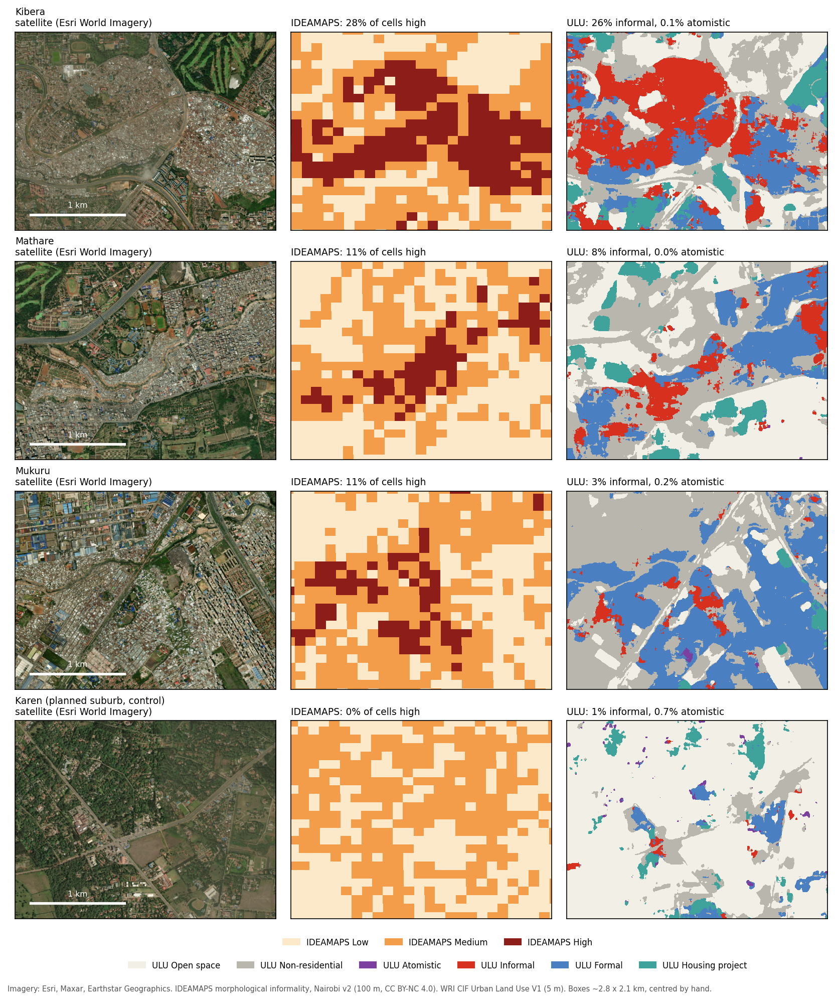

# Informality source comparison: IDEAMAPS vs. WRI CIF Urban Land Use (ULU)

2026-11-09. The model tags each agent's home with IDEAMAPS morphological informality. ULU was tested as a
replacement because it is distributed globally through WRI's CIF and covers the whole study area, which would
help the paper's portability claim. ULU cannot stand in for a slum map in Nairobi: it captures the core of
Kibera but labels much of Mathare and nearly all of Mukuru as formal. **IDEAMAPS stays the informality layer.**

Files in this folder:

| File | What it is |
|---|---|
| `analysis.md` | This note |
| `ulu_vs_ideamaps_slums.png` | Maps: satellite, IDEAMAPS and ULU for three settlements and a control |
| `map_slum_check.py` | Makes the maps (needs internet for the satellite tiles) |
| `compare_ulu_ideamaps.py` | Settlement shares, cell-by-cell agreement and exposure by home group |
| `comparison_output.txt` | Output of `compare_ulu_ideamaps.py` |

## The two layers

| | IDEAMAPS | ULU |
|---|---|---|
| Source | IDEAMAPS Morphological Informality, Nairobi v2 (Hafner et al. 2026), CC BY-NC 4.0 | WRI CIF `UrbanLandUse`, Earth Engine `projects/wri-datalab/cities/urban_land_use/V1` |
| Resolution | 100 m cells | 5 m pixels |
| Classes | low / medium / high morphological informality | 0 open space, 1 non-residential, 2 atomistic, 3 informal, 4 formal, 5 housing project |
| What it classifies | Building morphology: size, density, irregularity, visible roads | Apparently plot and street layout (residential typology) |
| Coverage of study area | Built-up core only; 513 of 20,000 agents have no class | Whole study area |
| Local files | `data/raw/ses/nairobi_ideamaps_morphological_informality.csv` | `data/raw/nairobi_ulu-all.tif` (all classes), `data/raw/nairobi_ulu3.tif` (class 3 removed) |

The meanings of ULU's classes are read from the CIF code, not from ULU's own documentation. They need
confirming before ULU is cited. Note that CIF's `ulu_class=k` argument *removes* class k; it does not select it.

## Maps of known settlements

Boxes are about 2.8 × 2.1 km, centred by hand.

- **Kibera:** ULU does fairly well. A large informal patch covers the core, roughly where IDEAMAPS marks
  "high". But ULU calls the dense eastern part formal.
- **Mathare:** partial. ULU marks patches of the valley as informal, but much of the dense strip along the
  river is formal or non-residential. IDEAMAPS follows the whole valley.
- **Mukuru:** ULU misses it. The settlement is plain on the imagery and IDEAMAPS marks it "high", but ULU calls
  almost all of it formal (3% informal).
- **Karen (planned suburb, control):** ULU correctly shows mostly open space. IDEAMAPS rates much of it
  "medium", likely because large houses scattered among trees read as irregular.

## Informal alone vs. informal + atomistic

Pooling ULU's "atomistic" (unplanned) class with "informal" changes almost nothing. Atomistic covers 0.43% of
the raster and adds 13 km² to informal's 127 km². In the settlements it is 0–0.4% of the area.

Share of each area in the ULU definition (approximate boxes):

| Area | ULU informal | ULU informal + atomistic | Any ULU residential |
|---|---|---|---|
| Kibera | 28.5% | 28.5% | 54% |
| Mathare | 11.7% | 11.7% | 38% |
| Korogocho | 18.3% | 18.3% | 40% |
| Mukuru | 3.2% | 3.6% | 51% |
| Karen (control) | 0.5% | 1.1% | 9% |

## Agreement with IDEAMAPS, cell by cell

For each of the 110,463 IDEAMAPS cells, the share of its area in ULU informal:

| IDEAMAPS class | Mean share ULU informal | Cells with any | Cells ≥ 50% | Where ULU informal area falls |
|---|---|---|---|---|
| Low | 5.5% | 14.5% | 5.1% | 41% |
| Medium | 10.2% | 30.4% | 8.9% | 54% |
| High | 40.8% | 75.0% | 40.7% | 4.5% |

- ULU marks 41% of IDEAMAPS "high" area as informal (the same with atomistic added).
- Only about 4% of ULU's informal area lies in "high" cells; 95% is in "low" or "medium".
- Rank correlation with the IDEAMAPS class is 0.21 (pooled: 0.29) over all cells. That mostly reflects
  built-up against open land. Within residential land (cells > 5% residential, informal as a share of
  residential area) it is −0.02 (pooled: 0.04).
- Across all classes, IDEAMAPS "high" cells split almost evenly between ULU informal (41%) and formal (37%).

## Effect on the exposure results

Mean daily exposure (°C·min above 26 °C UTCI) by home group, main run (20,000 agents, seed 42, with the
2026-11-08 routing fixes). ULU groups use the informal share within a 100 m box around the home, matching the
IDEAMAPS cell size.

| Home group | Agents | Mean [95% CI] | Median |
|---|---|---|---|
| IDEAMAPS low | 8,184 | 277 [271–283] | 207 |
| IDEAMAPS medium | 9,764 | 256 [250–261] | 190 |
| IDEAMAPS high | 1,539 | 196 [184–208] | 124 |
| IDEAMAPS no class (outside extent) | 513 | 607 [558–660] | 379 |
| ULU informal: none within 100 m | 10,800 | 286 [281–292] | 208 |
| ULU informal: 1–49% | 5,873 | 251 [244–258] | 180 |
| ULU informal: ≥ 50% | 3,327 | 244 [235–253] | 175 |
| ULU informal + atomistic: ≥ 50% | 3,425 | 244 [235–253] | 176 |

- Both layers put informal homes on the less-exposed side: trips from dense central settlements are short.
- The gap is half as large under ULU (about 42 °C·min against 81 for IDEAMAPS high vs. low).
- The two layers mostly flag different homes: 17–18% of ULU's mostly-informal homes are IDEAMAPS "high", and
  38% of IDEAMAPS "high" homes are mostly ULU informal.
- An earlier comparison (2026-11-08) grouped homes by their *dominant* ULU type and found "unplanned" homes
  more exposed than formal ones. That grouping put peripheral homes with little residential land into the
  unplanned groups, so it reflected distance from the centre. Measured as informal share, as here, the
  direction matches IDEAMAPS.

## Implications for the paper

- Keep IDEAMAPS for the informality results (Table 5, Figure 4b, the informality gap). Informality only groups
  results; it does not set behaviour, so the choice does not change the simulation.
- Portability (§9.7): a global land-use typology (ULU) was tested and does not identify Nairobi's slums
  reliably, so a portable informality layer is still a data gap. This fits the low-data framing.
- Limitation: IDEAMAPS covers only the built-up core (513 agents unclassified, mostly on the far periphery,
  mean 607 °C·min), and its "medium" class also catches low-density leafy suburbs such as Karen.
- Before citing ULU: confirm its class definitions, and whether Nairobi was in its training data, with the WRI
  team that maintains it.
