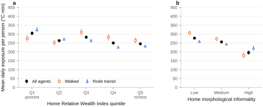

## Model run

10,000 agents on one simulated weekday, 06:00–20:00, in 60-second steps (random seed 42). Each agent lives at a location drawn from WorldPop population density and makes a round trip: out from home to a destination chosen by trip purpose (work, school, market, other), a stay at the destination, and back. Each trip is walked the whole way or ridden by matatu or bus, by distance-based walk shares (JICA 2014) and a route choice calibrated to the WRI Nairobi rider survey (2023). Heat exposure is the sum, over every minute spent outdoors (walking or waiting at a stop), of the degrees by which the Universal Thermal Climate Index (UTCI) at the agent's position exceeds 26 °C, the lower bound of UTCI's moderate heat stress category; minutes riding inside a vehicle add nothing. UTCI comes from 10 m hourly rasters for 14 March 2025.

Across all agents, mean daily exposure is 313 °C·min (median 202; 90th percentile 700). 3.6% of agents have zero exposure: all their outdoor minutes were at UTCI of 26 °C or below.

## Model parameters

Table 1 lists every behavioural rule and parameter of the main run, which agent attributes it depends on, and its source. Age group and sex are assigned to each agent from WorldPop at its home location. Age sets two rules, both for children (0–14): they make only school trips, and they leave for school before 08:00. Sex sets none. Purpose shares of everyone over 14, mode choice, walking speed and waiting behaviour are the same for all ages and both sexes: the calibration uses no age or sex breakdowns, the WRI rider survey interviewed only adults (18+) riding buses and matatus, and the JICA walk-share curves are given by trip purpose only. Wealth (RWI) and informality are used only to group results, not to set behaviour. Table 2 gives the resulting composition of the simulated population and its mix of trip purposes.

| Rule or parameter | Value in the main run | Differs by | Source |
|:---|---:|---:|---:|
| *Who travels* | | | |
| Home location | Drawn in proportion to population (100 m grid), snapped to the nearest street node | — | WorldPop 100 m population, Kenya |
| Age group | Child 0–14, youth 15–19, adult 20–59, elderly 60+; drawn from the age mix of the agent's home grid cell | Home location | WorldPop age-group rasters (youth = total − children − adults 20+) |
| Sex | Drawn from the female share of the home grid cell, independently of age | Home location | WorldPop female-population raster |
| Trips per agent | One round trip: home → destination → home. Every agent travels (travel probability 1) | — | Model design |
| Trip purpose | Children 0–14: school only. Everyone else: work 40%, school 20%, market 25%, other 15% | Age: children vs. others (same for both sexes) | Children: school attendance; others: assumption |
| Destination | OpenStreetMap amenity of the trip's purpose, chosen with weight distance^−1.5^ | Purpose, distance | Calibrated: WRI rider survey Q11 (median time on board 22.7 min) |
| *When* | | | |
| Outbound departure time | Two normal peaks (SD 30 min) at 07:24 (66%) and 16:45 (14%), 20% spread evenly over 06:00–20:00 | — | Assumption, refit so outbound + return departures match an assumed all-journey profile |
| Departure timing by purpose | Profile × purpose multiplier per time band, e.g. work ×1.49 at 06:00–09:00, market ×1.50 at 17:00–20:00 | Purpose | WRI rider survey Q9 (adults ≥ 18, bus/matatu riders, weekdays) |
| Children's school departures | Leave before 08:00 (school starts 08:00) | Age: children 0–14 only | Nairobi school day 08:00–15:30 |
| Trip home: work | Leave at 17:00 ± 1 h (normal), at least 60 min after arriving | Purpose | Assumption; Kenya public-service hours 08:00–17:00 |
| Trip home: school | Leave at 15:30 ± 30 min (normal), at least 60 min after arriving | Purpose (all ages alike) | Nairobi school day 08:00–15:30 |
| Trip home: market, other | Stay a log-normal time, median 45 min (market), 60 min (other); log-SD 0.6 | Purpose | Assumption |
| *How* | | | |
| Walk the whole way | Probability by trip length d (km): under 1.3 km, work 67%, school 76%, market/other 83%; longer trips, work 37.9 − 12.2 ln d %, school 59.2 − 19.2 ln d %, market/other 51.8 − 15.4 ln d % | Purpose, distance | JICA (2014) Nairobi walk-split curves, 2013 household survey |
| Route for everyone else | Least cost: time riding + 5 × time walking + expected wait; may still be all walking | — | Calibrated: WRI rider survey Q8 (access walk time) |
| Walking speed | 1.2 ± 0.15 m/s (normal, one draw per person) | None (same for all ages) | Common pedestrian default |
| Wait to board | Exponential, mean 5.65 min | — | WRI rider survey Q15 (bus and matatu riders, n = 1,484) |
| Wait tolerance | Walk instead if the drawn wait exceeds 15 min | — | Assumption |

Table: **Table 1.** Agent behaviour as modelled in the main run.

Note. Differs by: the agent attributes a rule depends on; — = the same for every agent. Age changes only children's trips (school only, leaving before 08:00); sex changes nothing. Where a rule depends on purpose, it applies equally to every age and sex (for example, adult students and children both head home from school at 15:30). Calibrated: destination distance decay and the walking-time weight were fitted jointly to the WRI Nairobi rider survey (2023), and with the JICA curves they give a 43% walk share, as reported by Tatah et al. (2023). WRI rider survey: adults 18 and over, bus and matatu riders, weekdays.

| Group | n | % of agents | Work (%) | School (%) | Market (%) | Other (%) |
|:---|---:|---:|---:|---:|---:|---:|
| All agents | 10,000 | 100.0 | 29 | 41 | 19 | 11 |
| *Age group* | | | | | | |
| Child (0–14) | 2,688 | 26.9 | 0 | 100 | 0 | 0 |
| Youth (15–19) | 863 | 8.6 | 39 | 19 | 29 | 13 |
| Adult (20–59) | 6,237 | 62.4 | 40 | 20 | 25 | 16 |
| Elderly (60+) | 212 | 2.1 | 36 | 25 | 27 | 12 |
| *Sex* | | | | | | |
| Female | 4,841 | 48.4 | 29 | 41 | 19 | 11 |
| Male | 5,159 | 51.6 | 29 | 41 | 19 | 11 |

Table: **Table 2.** Simulated population by age group and sex, and its trip purposes (% of each group).

Note. Age group and sex come from the WorldPop rasters at each agent's home; youth (15–19) is the residual of total minus children and adults 20+. Children make only school trips; agents over 14 share the population purpose weights, so their school trips stand for secondary-school, college and university students. Overall, 41% of agents make school trips. Purposes are not stored in the model's GIS export; they were reproduced exactly from the run's random seed (see purposes.py).

## Figures

{width=3.5in}

![**Figure 2.** Where exposure is picked up on the street network. (a) Total exposure accumulated on each street segment by everyone who walked it (54,462 segments with non-zero exposure). (b) Exposure of one person walking the segment (total divided by the number of distinct people), shown for segments walked by at least 5 people. Both directions of a street are combined. Light grey: segments walked but with no exposure above the threshold, and ward boundaries. Log colour scales. Place labels mark selected wards (CBD: Nairobi Central ward; Kibera: Laini Saba and Sarangombe wards; Dandora and Eastleigh: their wards combined).](fig2_segment_maps.svg){width=6.5in}

{width=3.5in}

{width=6.5in}

## Tables

| Group | n | Zero exposure (%) | Mean per person [95% CI] | Median per person | 90th pct. per person |
|:---|---:|---:|---:|---:|---:|
| All agents | 10,000 | 3.6 | 313 [305–321] | 202 | 700 |
| *Outbound mode* | | | | | |
| Walked (outbound trip) | 4,514 | 5.0 | 337 [323–350] | 157 | 934 |
| Rode transit (outbound trip) | 5,486 | 2.5 | 293 [285–302] | 225 | 544 |
| *Age group* | | | | | |
| Child (0–14) | 2,688 | 0.0 | 368 [352–385] | 244 | 784 |
| Youth (15–19) | 863 | 6.3 | 299 [272–326] | 175 | 721 |
| Adult (20–59) | 6,237 | 4.8 | 290 [281–300] | 186 | 645 |
| Elderly (60+) | 212 | 4.2 | 337 [283–395] | 221 | 883 |
| *Gender* | | | | | |
| Female | 4,841 | 3.8 | 309 [298–321] | 201 | 678 |
| Male | 5,159 | 3.4 | 316 [306–327] | 203 | 717 |

Table: **Table 3.** Daily heat exposure per person (°C·min above 26 °C UTCI), overall and by group.

Note. Outbound mode is the mode of the trip from home; the trip home can differ (in a 3,000-agent check, 92% of agents used the same mode both ways). Age group and gender are drawn from WorldPop population grids at the home location. 95% confidence intervals of the mean are bootstrap percentile intervals.

| Destination type | n | Walked out (%) | Zero exposure (%) | Mean per person [95% CI] | Median per person | 90th pct. per person | Mean per person, walked | Mean per person, transit |
|:---|---:|---:|---:|---:|---:|---:|---:|---:|
| Work | 2,880 | 41 | 0.2 | 257 [245–270] | 171 | 532 | 264 | 252 |
| School | 4,138 | 48 | 0.0 | 372 [359–385] | 249 | 803 | 375 | 369 |
| Market | 1,871 | 45 | 14.3 | 276 [257–294] | 131 | 720 | 359 | 207 |
| Other | 1,111 | 46 | 7.9 | 300 [278–324] | 198 | 644 | 319 | 284 |

Table: **Table 4.** Daily heat exposure per person (°C·min above 26 °C UTCI) by destination type (trip purpose).

Note. Destination types: Work: offices, shops, commercial and industrial buildings and banks, plus schools, markets and health facilities as workplaces; School: schools, colleges and universities; Market: supermarkets and marketplaces; Other: places of worship, community centres and libraries (OpenStreetMap). Each agent makes one round trip, to one destination of its trip purpose and back; destinations are chosen with weight distance^−1.5^. Walked out: share whose outbound trip was walked the whole way. Mean, walked / transit: mean exposure by outbound mode. Purposes are not stored in the model's GIS export; they were reproduced exactly from the run's random seed (see purposes.py).

| Home area | n | Mean per person [95% CI] | Median per person | 90th pct. per person | Mean per person, walked | Mean per person, transit |
|:---|---:|---:|---:|---:|---:|---:|
| *Relative Wealth Index quintile* | | | | | | |
| Q1 (poorest) | 2,027 | 343 [323–363] | 199 | 773 | 348 | 339 |
| Q2 | 2,255 | 317 [302–332] | 208 | 738 | 318 | 316 |
| Q3 | 1,719 | 321 [304–338] | 226 | 662 | 371 | 281 |
| Q4 | 2,002 | 293 [276–309] | 188 | 674 | 336 | 260 |
| Q5 (richest) | 1,995 | 291 [274–307] | 196 | 605 | 320 | 265 |
| *Morphological informality* | | | | | | |
| Low | 4,037 | 317 [306–330] | 210 | 707 | 365 | 282 |
| Medium | 4,904 | 297 [288–307] | 201 | 642 | 325 | 275 |
| High | 798 | 217 [198–236] | 134 | 478 | 200 | 246 |

Table: **Table 5.** Daily heat exposure per person (°C·min above 26 °C UTCI) by the wealth and informality of the home location.

Note. Relative Wealth Index (Chi et al. 2022; Data for Good at Meta, ~2.4 km tiles): quintiles over all agents. Morphological informality (IDEAMAPS; Hafner et al. 2026): class of the home's 100 m grid cell, from the form of buildings and roads (low: large, detached, regularly arranged buildings; high: small, close-together, irregularly arranged buildings with roads hard to see or absent). The layer covers Nairobi's built-up core; 261 agents outside the informality layer are excluded from the informality rows (and from Figure 4b).

| Street | Road class | Length (m) | People | Person-min | Total °C·min | °C·min per person |
|:---|---:|---:|---:|---:|---:|---:|
| Juja Road | secondary | 458 | 186 | 1,166 | 4,525 | 24.3 |
| Koma Rock Road | secondary | 243 | 196 | 664 | 4,006 | 20.4 |
| Kangundo Road | trunk | 442 | 100 | 614 | 3,861 | 38.6 |
| Thika Road | trunk | 1019 | 39 | 561 | 3,501 | 89.8 |
| Outer Ring Road | primary | 806 | 50 | 551 | 3,403 | 68.1 |
| Outer Ring Road | secondary | 596 | 66 | 539 | 3,317 | 50.3 |
| Mama Ng'endo Road | unclassified | 209 | 254 | 751 | 3,268 | 12.9 |
| Outer Ring Road | secondary | 320 | 117 | 515 | 3,242 | 27.7 |
| Lang'ata Link Road | secondary | 303 | 115 | 476 | 3,034 | 26.4 |
| Road to Utawala Academy | unclassified | 2423 | 14 | 505 | 3,025 | 216.1 |

Table: **Table 6.** The ten street segments with the most total exposure.

Note. A segment is the stretch of street between two network nodes, both directions combined. People: distinct agents who walked it. Person-min: total minutes spent walking it.

| Stop | People waiting | Person-min waiting | Total °C·min | °C·min per person |
|:---|---:|---:|---:|---:|
| Kangemi Terminus | 73 | 373 | 4,051 | 55.5 |
| Maziwa | 96 | 468 | 3,725 | 38.8 |
| Olympic Primary School | 82 | 398 | 3,532 | 43.1 |
| Kenafric | 84 | 392 | 3,027 | 36.0 |
| Mother Teresa Road | 72 | 352 | 2,881 | 40.0 |
| Thayo | 46 | 253 | 2,635 | 57.3 |
| Kwa DC | 77 | 415 | 2,434 | 31.6 |
| Shell Petrol Station/Catholic Church | 47 | 259 | 2,381 | 50.7 |
| Kanungaga | 73 | 351 | 2,356 | 32.3 |
| Tumaini/Tassia | 64 | 352 | 2,114 | 33.0 |

Table: **Table 7.** The ten transit stops with the most exposure while waiting to board.

Note. Waiting at stops accounts for 8.1% of all exposure; walking accounts for the rest.

| Ward | Agents | Mean per resident | Median per resident | Mean RWI | Medium/high informality (%) |
|:---|---:|---:|---:|---:|---:|
| *Highest mean exposure* | | | | | |
| Muthwani | 55 | 1288 | 998 | 0.40 | 9 |
| Ruai | 97 | 800 | 431 | 0.79 | 41 |
| Mwihoko | 45 | 610 | 529 | 0.76 | 18 |
| Imara Daima | 27 | 599 | 430 | 0.70 | 41 |
| Ndenderu | 64 | 572 | 465 | 1.07 | 67 |
| *Lowest mean exposure* | | | | | |
| Lindi | 136 | 148 | 77 | 1.11 | 99 |
| Huruma | 90 | 128 | 61 | 0.92 | 80 |
| Mlango Kubwa | 51 | 115 | 48 | 1.31 | 67 |
| Mabatini | 44 | 83 | 72 | 0.82 | 82 |
| Ngei | 83 | 76 | 46 | 0.83 | 67 |

Table: **Table 8.** Wards with the highest and lowest mean daily exposure per resident (°C·min above 26 °C UTCI).

Note. Wards with at least 15 simulated residents (115 of 128 wards in the study area). Mean RWI: mean Relative Wealth Index at residents' homes. Medium/high informality: share of residents whose home cell is classed medium or high.

# Behavioural sensitivity

## Method

Which behavioural assumptions drive the results? 17 behavioural factors (Table 9) were screened with the Morris method of elementary effects. Each of 10 trajectories starts at a random point on a 4-level grid over the factor ranges and changes one factor at a time by two-thirds of its range; μ\* is the mean absolute change in an outcome per such step. Each run simulates 3,000 agents making a round trip, with the model otherwise as in the main results: 180 Morris runs plus 5 baseline replicates.

## Results

At the baseline, mean exposure is 311 °C·min per person (seed-to-seed SD 6), with 65 minutes outdoors; 73% of exposure is picked up on the trip home. Across all runs, mean exposure ranged from 161 to 860 °C·min. 15 of the 17 factors have μ\* more than twice the seed SD. The most influential are wait tolerance (163), destination distance decay (133), walk-share shift (103), mean walking speed (87) and mean boarding wait (71 °C·min; Figure 5, Table 11).

Factors act through one of two channels (Figure 6). Route and mode behaviour (wait tolerance, destination distance decay, walk share, walking speed, boarding wait, walking-time weight) changes how long people are outdoors. Timing behaviour (morning departure peak, purpose-specific departure timing, work and school end times) barely changes minutes outdoors but shifts when in the day they fall, and so the UTCI experienced. Work end time (μ\* 54) acts almost entirely through temperature: a later end moves the trip home out of the afternoon heat. School end time acts the same way (μ\* 29); it matters because every child makes a school round trip and comes home in the mid-afternoon.

The wait-tolerance effect is a threshold, not a gradient (Figure 8). At a tolerance of 5 minutes, below the 5.65-minute mean boarding wait, mean exposure averaged 561 °C·min and 119 minutes outdoors across runs, because most would-be riders walk instead; from 13 to 30 minutes it was nearly flat (282–312 °C·min). Its large μ\* and σ come almost entirely from steps to or from the 5-minute level.

The equity gaps (Figure 7) are most sensitive to wait tolerance, walk share and destination distance decay, that is, to whether people ride and how far they travel. They are noisy at the baseline (Table 10), so their rankings are less certain than those for the city-wide outcomes.

## Figures

{width=4.6in}

{width=6.5in}

{width=6.5in}

{width=4.8in}

## Tables

| Factor | Range | Baseline | Source of baseline / range |
|:---|---:|---:|---:|
| *Destination and route choice* | | | |
| Destination distance decay (exponent) | 1.1–1.9 | 1.5 | WRI rider survey Q11 median ride time (calibration.py) |
| Walking-time weight in route choice (x riding) | 2–6× | 5× | WRI rider survey Q8 access times (calibration.py); literature 1.5-2.5 |
| Walk share vs. JICA distance curves (+- pct points) | -15–15 pp | 0 pp | JICA 2014 Nairobi walk-split curves (2013 person-trip survey) |
| *Walking* | | | |
| Walking speed, mean (m/s) | 1–1.4 m/s | 1.2 m/s | literature default |
| Walking speed, SD between people (m/s) | 0.05–0.3 m/s | 0.15 m/s | assumption |
| *Waiting for transit* | | | |
| Mean boarding wait (min) | 4.5–7 min | 5.65 min | WRI rider survey Q15; bus 5.1, matatu 6.7, 06-09 4.8, 15-21 6.4 |
| Wait tolerance before walking instead (min) | 5–30 min | 15 min | assumption |
| *Outbound departure time* | | | |
| Morning outbound departure peak (hour) | 6.5–8.5 h | 7.4 h | assumption; refit for round trips (departure_fit.py) |
| Share of outbound trips in morning peak | 0.5–0.8 | 0.66 | assumption; refit for round trips (departure_fit.py) |
| Evening outbound departure peak (hour) | 15.75–18 h | 16.75 h | assumption; refit for round trips (departure_fit.py) |
| Share of outbound trips in evening peak | 0–0.3 | 0.14 | assumption; refit for round trips (departure_fit.py) |
| Purpose-specific departure timing (x survey tilt) | 0–1.5× | 1× | WRI rider survey Q9 (tilt = 1) |
| *Trip purpose and the trip home* | | | |
| Work share of trip purposes | 0.25–0.55 | 0.4 | assumption |
| Work end time, mean (hour) | 16–18.5 h | 17 h | assumption; Kenya public-service hours 08:00-17:00 |
| School end time, mean (hour) | 15–16.5 h | 15.5 h | assumption; Nairobi school day 08:00-15:30 |
| Shopping/market dwell time, median (min) | 20–120 min | 45 min | assumption |
| Other-purpose dwell time, median (min) | 20–180 min | 60 min | assumption (places of worship, community centres, libraries) |

Table: **Table 9.** Behavioural factors varied in the sensitivity analysis.

Note. Geography (street network, heat rasters, population, amenities) and the transit service (GTFS routes and frequencies) are held fixed. Ranges for survey-calibrated factors span the WRI rider survey's own sub-group fits; the others are assumptions around the model default. Not varied: trip rate (one round trip per agent), travel probability (scales who travels, not the exposure of those who do), minimum stay and dwell-time spread (their medians are varied instead), and demographic modifiers (neutral by default).

| Outcome | Mean | SD | CV |
|:---|---:|---:|---:|
| Mean exposure (°C·min) | 311 | 6 | 1.9% |
| Median exposure (°C·min) | 197 | 3 | 1.3% |
| 90th-percentile exposure (°C·min) | 689 | 13 | 1.8% |
| Minutes outdoors | 65.5 | 0.9 | 1.3% |
| Mean UTCI while outdoors (°C) | 29.14 | 0.07 | 0.2% |
| Share of trips using transit | 0.549 | 0.009 | 1.7% |
| Mean exposure, walk-only trips (°C·min) | 334 | 12 | 3.7% |
| Mean exposure, transit trips (°C·min) | 292 | 5 | 1.7% |
| Share of exposure on the trip home | 0.734 | 0.014 | 1.9% |
| Share home by 20:00 | 0.913 | 0.005 | 0.5% |
| Wealth gap, poorest − richest RWI quintile (°C·min) | 64 | 34 | 53.0% |
| Informality gap, medium/high − low (°C·min) | -28 | 14 | 51.0% |

Table: **Table 10.** Outcomes at the baseline parameters over 5 replicate runs with different random seeds.

Note. 3,000 agents per run. The SD is the sampling noise of a single run and the noise floor for the Morris indices. Elementary effects themselves are less noisy than this, because each step of a trajectory reuses the previous run's seed (common random numbers).

| Rank | Factor | Dir. | μ* (95% CI) | μ | σ | μ* minutes outdoors | μ* UTCI (°C) |
|:---|---:|---:|---:|---:|---:|---:|---:|
| 1 | Wait tolerance before walking instead (min) | ↓ | 163 (71–289) | -163 | 181 | 32.4 | 0.39 |
| 2 | Destination distance decay (exponent) | ↓ | 133 (79–201) | -133 | 105 | 27.2 | 0.18 |
| 3 | Walk share vs. JICA distance curves (+- pct points) | ↑ | 103 (85–123) | 103 | 33 | 21.4 | 0.27 |
| 4 | Walking speed, mean (m/s) | ↓ | 87 (66–109) | -87 | 37 | 18.5 | 0.13 |
| 5 | Mean boarding wait (min) | ↑ | 71 (45–103) | 71 | 49 | 15.5 | 0.11 |
| 6 | Walking-time weight in route choice (x riding) | ↓ | 58 (38–76) | -58 | 34 | 12.7 | 0.04 |
| 7 | Work end time, mean (hour) | ↓ | 54 (34–76) | -54 | 37 | 3.0 | 0.56 |
| 8 | Morning outbound departure peak (hour) | ↑ | 44 (28–62) | 44 | 31 | 0.3 | 1.03 |
| 9 | Share of outbound trips in evening peak | ↓ | 42 (23–65) | -39 | 41 | 4.8 | 0.26 |
| 10 | Evening outbound departure peak (hour) | ↓ | 34 (13–62) | -34 | 41 | 2.6 | 0.38 |
| 11 | Work share of trip purposes | ↓ | 30 (21–41) | -26 | 25 | 1.9 | 0.40 |
| 12 | School end time, mean (hour) | ↓ | 29 (22–39) | -29 | 15 | 0.5 | 0.38 |
| 13 | Walking speed, SD between people (m/s) | ↑ | 22 (10–35) | 22 | 21 | 4.0 | 0.05 |
| 14 | Purpose-specific departure timing (x survey tilt) | ↕ | 21 (16–26) | 15 | 19 | 3.3 | 0.66 |
| 15 | Share of outbound trips in morning peak | ↓ | 17 (13–21) | -14 | 12 | 3.3 | 0.64 |
| 16 | Other-purpose dwell time, median (min) | ↕ | 7 (6–9) | 3 | 8 | 1.2 | 0.16 |
| 17 | Shopping/market dwell time, median (min) | ↕ | 6 (4–8) | 3 | 6 | 1.2 | 0.15 |

Table: **Table 11.** Morris sensitivity indices for mean daily exposure per person (°C·min above 26 °C UTCI) and for its two parts.

Note. μ\*: mean absolute elementary effect, with 95% bootstrap interval across trajectories; μ: signed mean; σ: standard deviation of the elementary effects (non-linearity or interaction with other factors). Dir.: ↑ / ↓ when |μ| ≥ 0.8 μ\*, otherwise ↕. Last two columns: μ\* for mean minutes outdoors and mean UTCI while outdoors. Indices for all twelve outcomes are in paper_nb02/table9_mu_star_all_outcomes.csv.
